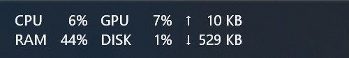
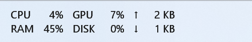

<div align="center">

# TaskbarMeter

**Windows 11 작업표시줄에 CPU · RAM · GPU · 디스크 · 네트워크를 보여주는 아주 가벼운 프로그램.**<br>
원래 Windows에 있던 것처럼 보이고, 메모리 약 1MB, 74KB 실행 파일 하나.

[](https://github.com/gutsguy/taskbar-meter/actions/workflows/build.yml)
[](https://github.com/gutsguy/taskbar-meter/releases/latest)

[](LICENSE)

<br>


[English](README.md) · **한국어**

</div>

## 기능

- CPU, RAM, GPU, 디스크, 네트워크 ↑↓ — 우클릭 메뉴에서 각각 켜고 끄기
- 작업표시줄과 같은 글꼴, 투명 배경, 라이트/다크 테마 자동
- 시계 옆 또는 왼쪽 끝 (위젯 버튼이 있으면 그 옆으로)
- 90% 이상이면 주황색 · 더블클릭하면 작업 관리자
- 설치·런타임 없음. 꺼 둔 항목은 자원을 쓰지 않음

## 리소스 사용량

| | TaskbarMeter | TrafficMonitor Lite 1.86 |
|---|---:|---:|
| 메모리 | **1.3MB** | 13.5MB |
| CPU | **0.02%** | 0.06% |
| 배포 | **파일 1개, 74KB** | 파일 약 60개 |

같은 PC, CPU + RAM + 네트워크 표시, 실제 사용 메모리(Private), 30초 평균.
스킨·그래프·온도가 필요하면 [TrafficMonitor](https://github.com/zhongyang219/TrafficMonitor)가 훨씬 많은 걸 합니다.

## 설치

[Releases](https://github.com/gutsguy/taskbar-meter/releases/latest)에서 `TaskbarMeter.exe`를 받아 실행하세요.
계속 쓰려면 우클릭 → **Windows 시작 시 실행**. SmartScreen 경고가 뜨면 **추가 정보 → 실행**.

## 빌드

```bat
build.cmd
```

[Zig](https://ziglang.org/download/) 0.17 이상이 `PATH`에 있어야 합니다 (또는 `ZIG` 지정). 프로그램 전체가 C 파일 하나: [`src/meter.c`](src/meter.c).

## 참고

- Windows 11에서 테스트했습니다. Windows 10은 테스트하지 않았습니다.
- 주 모니터만 지원. 온도는 지원하지 않습니다 (관리자 권한과 드라이버 필요).

## 라이선스

[MIT](LICENSE)
