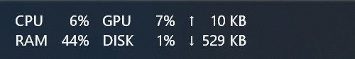

<div align="center">


# TaskbarMeter

**A tiny CPU / RAM / GPU / disk / network monitor for the Windows taskbar.**<br>
It looks like it shipped with Windows and uses about 1.3 MB of memory.

[](https://github.com/gutsguy/taskbar-meter/actions/workflows/build.yml)
[](https://github.com/gutsguy/taskbar-meter/releases/latest)

[](LICENSE)

<br>


**English** · [한국어](README.ko.md)

</div>

---

## Why

Most taskbar monitors bring their own box, background and font, and they cost tens of megabytes to show two numbers.
TaskbarMeter draws plain text in the taskbar's own font, follows your light/dark theme, and stays out of the way.

- **Native look.** Segoe UI, transparent background, matches the clock. Light and dark themes, any DPI.
- **Tiny.** A single ~90 KB `.exe`. No installer, no runtime, no config files.
- **Pay for what you show.** Meters you turn off are not sampled at all.

## Footprint

Measured on the same Windows 11 PC, showing CPU + RAM + network, averaged over 30 s.

| | TaskbarMeter | TrafficMonitor Lite 1.86 |
|---|---:|---:|
| Private memory | **1.3 MB** | 13.5 MB |
| CPU | **0.02 %** | 0.06 % |
| Download | **1 file, ~90 KB** | ~60 files, 1 MB zip |

With every meter turned on it uses about 7 MB (GPU counters are the expensive part). The left-end position adds about 2 MB.

> [TrafficMonitor](https://github.com/zhongyang219/TrafficMonitor) does far more: skins, graphs, temperatures, plugins.
> If you need those, use it. TaskbarMeter is for people who only want the numbers.

## Features

- CPU, RAM, GPU, disk and network (↑ upload / ↓ download), each can be turned on or off
- Values turn orange at 90 % and above
- Next to the clock, or at the left end of the taskbar (it moves past the Widgets button and out of the way of your app icons)
- Double-click opens Task Manager
- Survives Explorer restarts
- English and Korean menu (follows the Windows display language)

## Install

1. Download `TaskbarMeter.exe` from [Releases](https://github.com/gutsguy/taskbar-meter/releases/latest).
2. Run it.
3. Right-click the numbers → **Start with Windows**, if you want it on every boot.

Windows SmartScreen may warn about an unsigned app on first run: **More info → Run anyway**.

## Usage

| Action | Result |
|---|---|
| Double-click | Open Task Manager |
| Right-click | Toggle meters, show on left, start with Windows, exit |

Settings are stored in `HKCU\Software\TaskbarMeter`.

## Build from source

Requires [Zig](https://ziglang.org/download/) 0.17 or later (used as a C compiler, no Visual Studio needed).

```bat
git clone https://github.com/gutsguy/taskbar-meter
cd taskbar-meter
build.cmd
```

Set `ZIG` to the full path of `zig.exe` if it is not on your `PATH`.

## How it works

The whole program is one C file, [`src/meter.c`](src/meter.c), using only Win32 APIs.

- A layered child window is attached to the taskbar (`Shell_TrayWnd`) and redrawn once per second with per-pixel alpha.
- CPU from `GetSystemTimes`, RAM from `GlobalMemoryStatusEx`, network from `GetIfTable2` (physical adapters only).
- GPU and disk from Performance Counters (`GPU Engine`, `PhysicalDisk`), the same sources Task Manager uses.
- In left-end mode, UI Automation finds where the Widgets button ends, re-checked as soon as taskbar settings change.

## Limitations

- Built and tested for Windows 11. Windows 10 (1607+) should run it but is untested; there, a full taskbar's app buttons can slide under the meter, and vertical taskbars are not supported.
- Primary monitor's taskbar only.
- No temperatures. Reading them needs administrator rights and a kernel driver, which goes against the point of this app.

## Uninstall

Right-click → turn off **Start with Windows** → **Exit**, then delete the `.exe`.
Optionally delete the `HKCU\Software\TaskbarMeter` registry key.

## License

[MIT](LICENSE)
