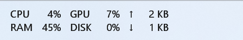

<div align="center">

# TaskbarMeter

**A tiny CPU / RAM / GPU / disk / network monitor for the Windows 11 taskbar.**<br>
Looks like part of Windows. About 1 MB of memory, one 74 KB exe.

[](https://github.com/gutsguy/taskbar-meter/actions/workflows/build.yml)
[](https://github.com/gutsguy/taskbar-meter/releases/latest)

[](LICENSE)

<br>


**English** · [한국어](README.ko.md)

</div>

## Features

- CPU, RAM, GPU, disk, network ↑↓ — turn each on or off from the right-click menu
- Taskbar font, transparent background, follows light/dark theme
- Next to the clock, or at the left end (steps around the Widgets button)
- Turns orange at 90 %+ · double-click opens Task Manager
- No installer, no runtime. Hidden meters cost nothing.

## Footprint

| | TaskbarMeter | TrafficMonitor Lite 1.86 |
|---|---:|---:|
| Memory | **1.3 MB** | 13.5 MB |
| CPU | **0.02 %** | 0.06 % |
| Download | **1 file, 74 KB** | ~60 files |

Same PC, CPU + RAM + network shown, private memory, 30 s average.
Want skins, graphs or temperatures? [TrafficMonitor](https://github.com/zhongyang219/TrafficMonitor) does far more.

## Install

Download `TaskbarMeter.exe` from [Releases](https://github.com/gutsguy/taskbar-meter/releases/latest) and run it.
Right-click → **Start with Windows** to keep it. If SmartScreen warns: **More info → Run anyway**.

## Build

```bat
build.cmd
```

Needs [Zig](https://ziglang.org/download/) 0.17+ on `PATH` (or set `ZIG`). The whole app is one C file: [`src/meter.c`](src/meter.c).

## Notes

- Tested on Windows 11. Windows 10 may work but is untested.
- Primary monitor only. No temperatures (they need admin rights and a driver).

## License

[MIT](LICENSE)
